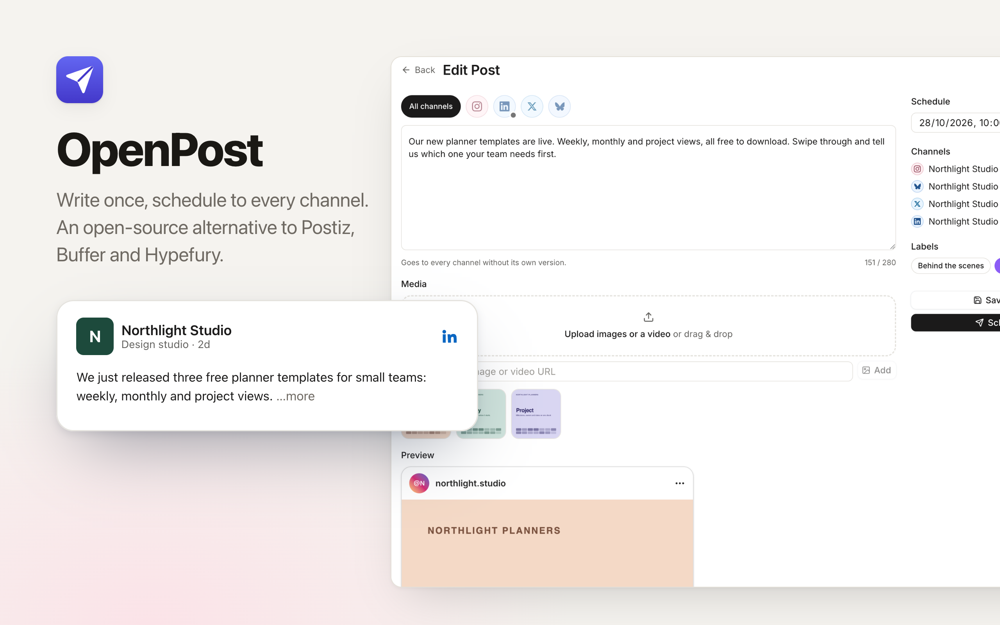
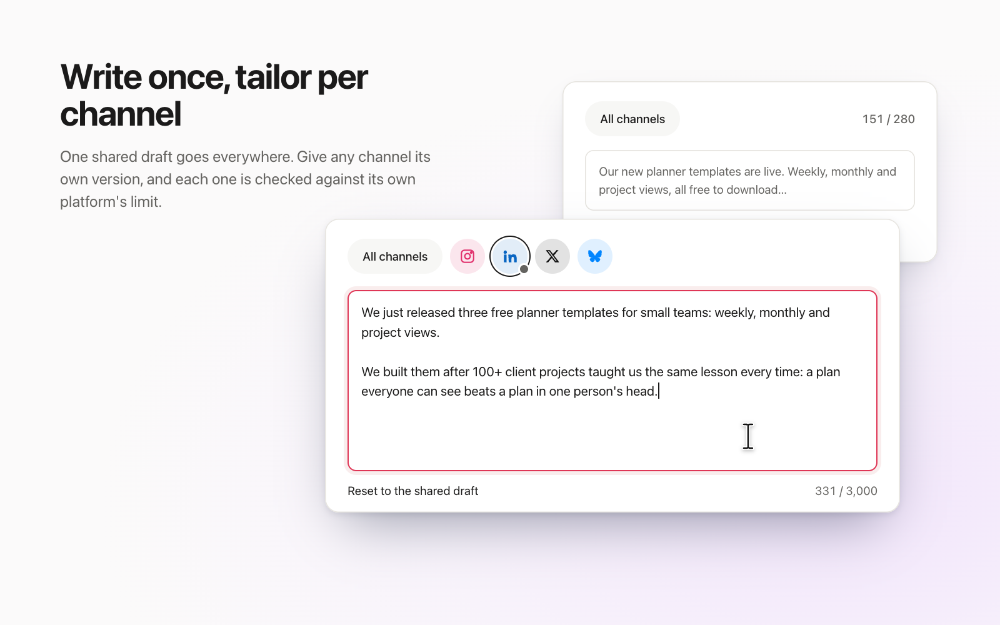
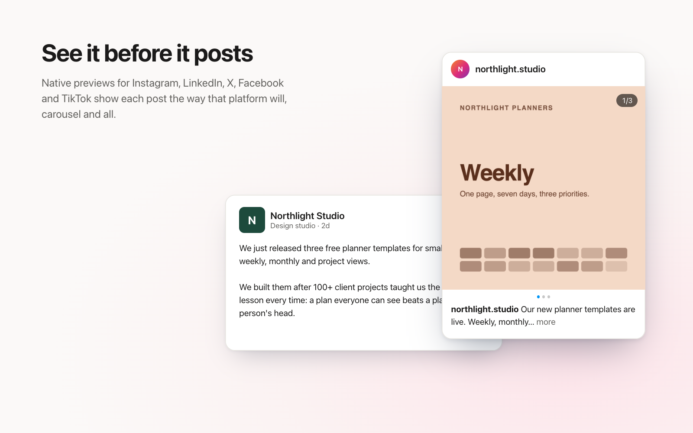
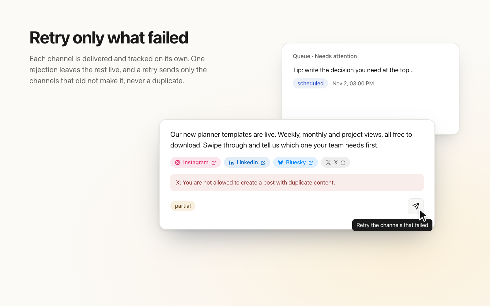
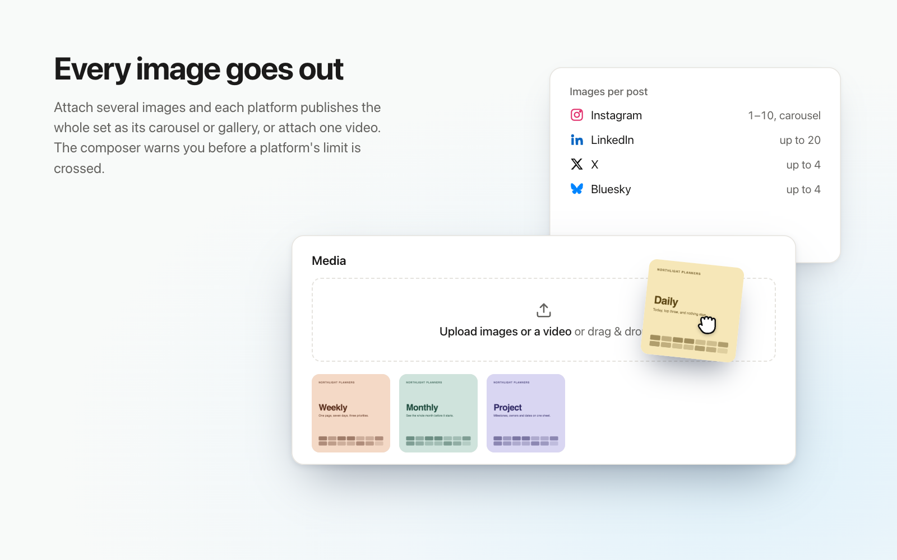

<picture>
  <source media="(prefers-color-scheme: dark)" srcset="readme-banner-dark.png" />
  
</picture>

# OpenPost: The Open-Source Postiz, Buffer & Hypefury Alternative

[](https://app.clawnify.com/deploy?repo=clawnify/OpenPost)

Write a post once, give any channel its own version, and schedule it to Instagram, LinkedIn, X, TikTok, Facebook and Bluesky from one calendar. OpenPost is a social media scheduler with a multi-channel composer, native previews, a queue, drafts and analytics. An open-source app template provided by [Clawnify.com](https://clawnify.com).

Think of it as an open-source alternative to **Postiz**, **Buffer**, **Hypefury**, **Typefully** and **Twitter Hunter**: a complete content scheduling system you can deploy and change to fit how your team posts.

## See it in action

Conceptual UI illustrations of the app's main capabilities, with fictional example data. Open an image to see the details.

| Write once, tailor per channel | See it before it posts |
|---|---|
| [](previews/compose.png) | [](previews/previews.png) |
| **Retry only what failed** | **Every image goes out** |
| [](previews/retry.png) | [](previews/media.png) |

## Features

- **Multi-channel composer**: write once and publish to several platforms, with each platform's character limit applied
- **A version per channel**: give any channel its own text; the shared draft only has to fit the channels still using it
- **Native previews**: see the post the way Instagram, LinkedIn, X, Facebook and TikTok will show it before it goes out
- **Calendar view**: a month grid of scheduled posts, colour-coded by platform
- **Queue**: scheduled posts by date, with failed and partial posts kept in it, counted as needing attention, until you deal with them
- **Drafts**: save unfinished posts and come back to them later
- **Channels**: add your social accounts with platform detection and colour coding
- **Labels**: tag posts with coloured labels
- **Media attachments**: attach several images and every platform publishes the whole set (carousel, gallery or multi-photo, whichever that platform calls it), or attach one video and it goes out as a video post
- **Analytics**: posts per channel, per label, and daily activity
- **Dashboard**: at-a-glance stats, upcoming posts and recent drafts
- **Direct publishing** to X, LinkedIn, Instagram, Facebook Pages, TikTok and Bluesky through the accounts connected in Clawnify
- **Publish once, exactly once**: a channel that has already gone out is never sent again, so retrying a half-delivered post, editing a post that is already live, or a scheduled delivery arriving twice all do the right thing instead of double-posting
- **URL routing**: bookmarkable pages (`/compose`, `/calendar`, `/queue`, `/drafts`, `/channels`, `/analytics`)

### Supported platforms

| Platform | Character limit | Images | Video | Publishing |
|----------|----------------|--------|-------|------------|
| X / Twitter | 280 | up to 4 | no | text, or a post with up to four images |
| LinkedIn | 3,000 | up to 20 | no | text, or a post with up to twenty images |
| Instagram | 2,200 | 1-10 | no | photo + caption; two or more images publish as a carousel (Business or Creator account, picked up from the connection) |
| Facebook | 63,206 | no stated cap | yes | text, one photo, one feed post with several photos, or a video, as a Page you manage |
| TikTok | 2,200 | 1-35 | yes | photo post (the first image is the cover), or a video post |
| Bluesky | 300 | up to 4 | no | text, with images and link cards |
| Mastodon | 500 | no | no | coming soon |
| Threads | 500 | no | no | coming soon |

A post carries either images or one video, never both: no platform here takes a mix.

Attaching more images than a platform accepts, or a video to a channel with no video
support above, fails **that channel only**, with the reason on the post, rather than
quietly publishing a subset or publishing the text on its own. The other channels in
the fan-out still go out, and the composer warns you before you get there.

Connect each account once in Clawnify (Settings → Integrations), then add it as a channel here. Facebook channels are Pages: the channel form lists the Pages the connected account manages so you can pick one.

## Quickstart

```bash
git clone https://github.com/clawnify/OpenPost.git
cd OpenPost
pnpm install
pnpm dev          # UI on :5173, API on :8787
```

Open `http://localhost:5173`. The database schema is applied automatically on startup.

Requires Node.js 20+ and pnpm (the tests need Node 22.5+, for `node:sqlite`).

### Tests

```bash
pnpm test
```

Runs the real API against an in-memory SQLite database, in process: no dev server and
nothing to deploy. Covers the publishing rules above by counting the calls the app
actually makes to each platform.

### Publishing

Publishing runs through the accounts connected in Clawnify, with no API keys in the app. On Clawnify, scheduled posts go out on their own at the scheduled time. Locally there is no connection or scheduler, so posts save and schedule, a scheduled post waits for you to publish it, and publishing reports each channel as not connected.

Each channel on a post is delivered and tracked on its own: one platform rejecting
the content marks that channel failed, with the reason, while the rest still go
out. The post then reads `partial`, and **Retry** sends only the channels that
did not make it. A published channel is never posted to twice, whether the
retry comes from you, from an edit, or from a scheduled delivery that arrives
more than once. There is no undo on a live post, so this is enforced in the
database rather than left to the caller.

## Tech stack

| Layer | Technology |
|-------|-----------|
| **Frontend** | Preact, TypeScript, Tailwind CSS v4, Vite |
| **Backend** | Hono API |
| **Database** | SQLite |
| **Media** | Object storage for uploaded images and video |
| **Icons** | Lucide |
| **Accounts** | Connected in Clawnify; the app never holds a platform token |

## Architecture

```
schema.sql          Database schema (channels, posts, labels, media)
demo/seed.sql       Optional fictional example calendar
src/
  shared/
    platforms.ts    Platform limits, colours and labels; which platforms take video, and the media rules the server enforces and the composer warns on
    media.ts        What an attachment is (image or video) and how its type is decided
  server/
    index.ts        Hono API: channels, labels, posts, publishing, stats
    db.ts           Database adapter
    credentials.ts  Connected-account adapter (production + local fallback)
    queue.ts        Scheduling adapter: delivers each scheduled post at its time
    uploads.ts      Storage for uploaded images and video
    bluesky.ts      Bluesky publishing (AT Protocol)
    tiktok.ts       TikTok publishing, which the platform completes asynchronously
    confirm.ts      Waits for a platform to finish a post it has only accepted
  client/
    app.tsx              Root component with router and navigation
    context.tsx          Preact context for app state
    hooks/
      use-app.ts         State management + CRUD operations
      use-router.ts      pushState URL router
    components/
      dashboard.tsx         Stats cards + upcoming posts
      post-composer.tsx     Multi-channel editor with per-channel versions and limits
      previews/             Native post previews per platform
      calendar-view.tsx     Month grid calendar
      queue-view.tsx        Scheduled posts queue
      drafts-view.tsx       Draft posts list
      channel-list.tsx      Channel management
      analytics-view.tsx    Bar charts and daily activity
      post-card.tsx         Post card with per-channel delivery status
      quick-edit-dialog.tsx Quick edit from the calendar
      platform-icon.tsx     Platform brand marks
      error-banner.tsx      Error display
test/
  harness.mjs              Boots the real API over an in-memory SQLite database
  publish-idempotency.mjs  Publishing is safe to run twice
  video-publishing.mjs     Video reaches the platforms that can take one
  instagram-accounts.mjs   One Instagram connection is one Instagram account
```

### API endpoints

| Method | Endpoint | Description |
|--------|----------|-------------|
| GET | `/api/channels` | List channels |
| POST | `/api/channels` | Create channel |
| PUT | `/api/channels/:id` | Update channel |
| DELETE | `/api/channels/:id` | Delete channel |
| POST | `/api/channels/:id/sync-profile` | Re-pull the channel's platform profile |
| GET | `/api/platforms/facebook/pages` | Pages the connected Facebook account manages (for the channel form) |
| GET | `/api/labels` | List labels |
| POST | `/api/labels` | Create label |
| PUT | `/api/labels/:id` | Update label |
| DELETE | `/api/labels/:id` | Delete label |
| GET | `/api/posts` | List posts (filterable by status, channel, date range) |
| GET | `/api/posts/:id` | Get post with channels, labels, media |
| POST | `/api/posts` | Create post |
| PUT | `/api/posts/:id` | Update post |
| DELETE | `/api/posts/:id` | Delete post |
| GET | `/api/posts/calendar?month=YYYY-MM` | Posts grouped by day for calendar |
| POST | `/api/posts/:id/publish` | Publish post to assigned channels |
| POST | `/api/upload` | Upload an image or video |
| GET | `/api/stats` | Dashboard stats + per-channel/label breakdowns |

## Deploy

Use the **Deploy with Clawnify** button above, or from a checkout:

```bash
npx clawnify deploy
```

## License

MIT
